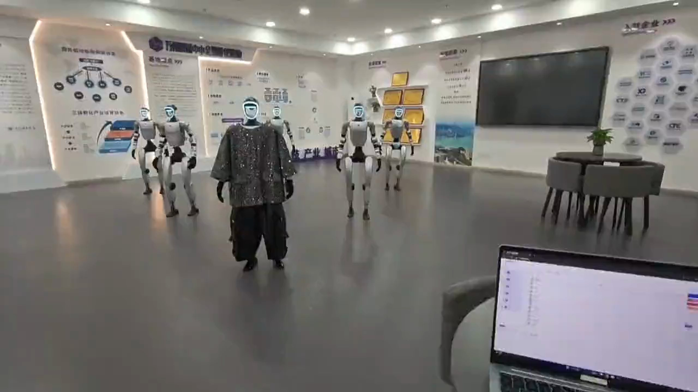
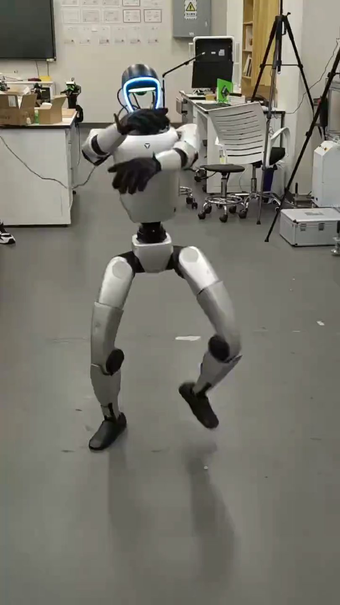
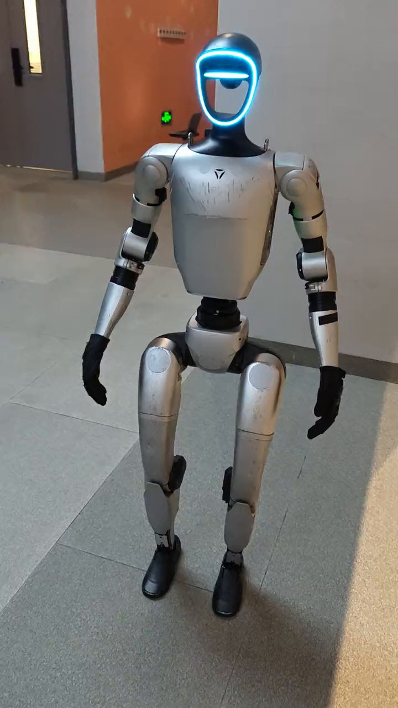

## 为什么写博客

机器人方向的日常技术栈很杂：C++、ROS、强化学习、仿真、真机调试。
写下来有三个理由：

1. **沉淀** —— 踩过的坑记下来，下次不踩第二次
2. **交流** —— 开源社区教会我很多，希望也能帮到后来的人
3. **让人看得见** —— 交付靠的是信任，作品和记录比自我介绍有用

第三条是最近才想明白的。做项目做久了会发现，**能跑通的东西如果没人知道，等于没做**。
尤其是在接触客户的时候：对方没法验证你说的是真是假，只能看你拿出过什么。

## 会写什么

- **ROS / ROS2** —— 使用经验、源码阅读、工具链
- **强化学习与运控** —— 训练、retarget、sim2real 的实际问题
- **项目复盘** —— 交付里真正卡住的地方
- **偶尔** —— 读书笔记和技术判断

不会写什么：

- 搬运论文摘要
- 没跑通过的"教程"
- 只说结论不说过程的经验帖

我的规矩是：**一个东西我自己没在真机上跑通过，就不写成结论。** 写不出来就空着，不硬凑。

## 一个例子

这是 G1 在实验室里做动作的样子。左边的面罩 LED 亮着，说明它正在执行一段已部署的动作策略。

## 已经写了的

- [我的机器人开发技术栈](/2026/07/22/2026-07-22-my-tech-stack/) —— 在用的工具和两个选型教训
- [把 29dof 动作裁成 23dof](/2026/11/08/2026-11-08-23dof-retarget/) —— 完整的数据链路，六道验证

## 另一个例子

这是同一套设备在展厅里带路。同一个机器人，换一块场地，做的是完全不同的事。

## 关于我

深圳技术大学计算机科学与技术专业，2023–2027。
在做宇树 G1 的二次开发：全身运动控制、导航导览、多机群控。

详细履历见 [履历页](/about/)，项目在 [项目页](/projects/)。
在接的落地交付的事情在 [工作室](https://chenlockyer.github.io/studio/)。

欢迎在 [GitHub](https://github.com/chenlockyer) 上交流。

---

*让东西真的动起来。*
