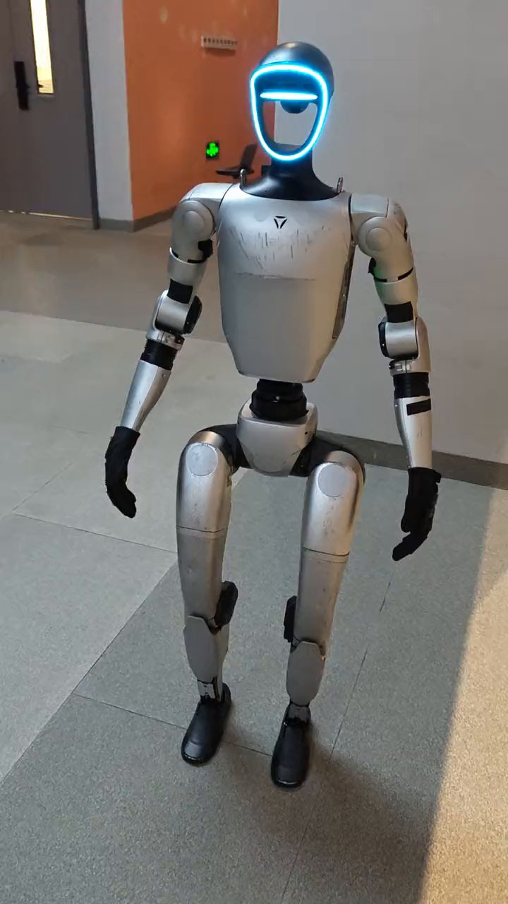
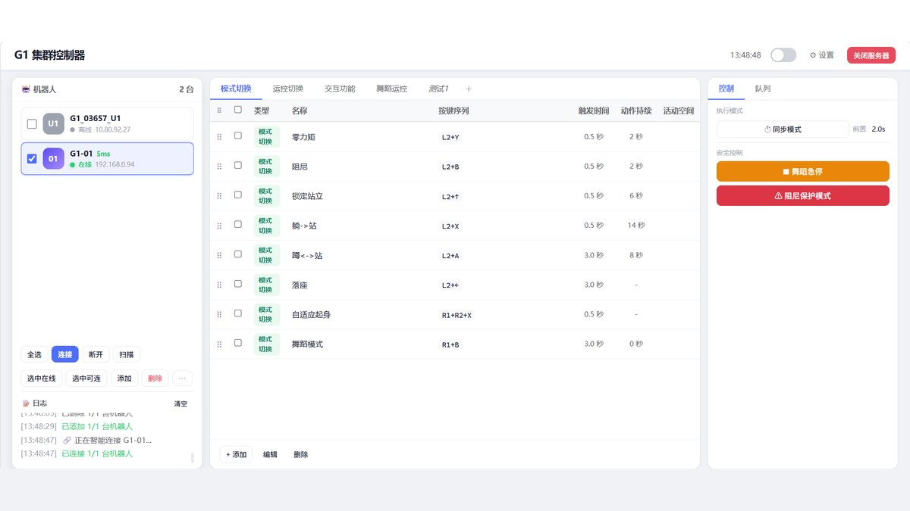
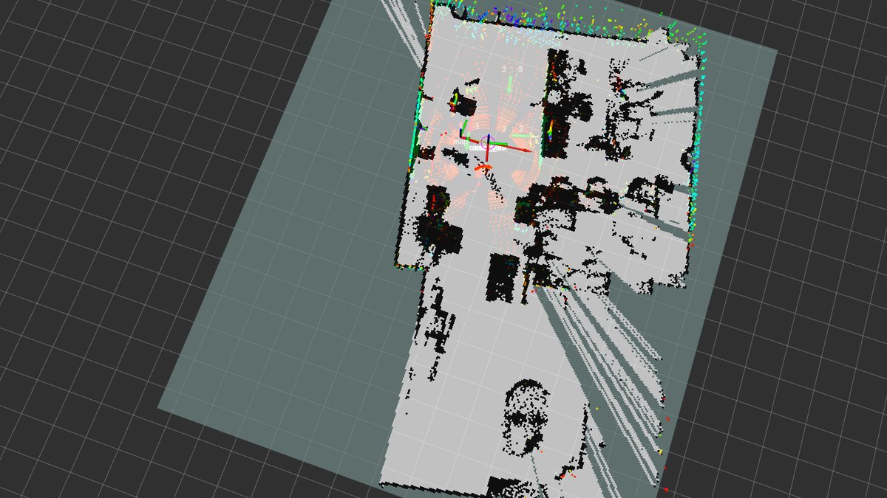

## 编程语言

### Python —— 训练与胶水

- **PyTorch** —— 强化学习训练、动作数据处理
- **OpenCV + NumPy** —— 图像处理与矩阵运算
- **Flask** —— 机器人控制 API 的后端中间层

### C++ —— 性能敏感的地方

- ROS / ROS2 节点开发
- 实时控制、控制器代码
- CMake 构建

## 机器人框架

| 工具 | 用途 |
|------|------|
| **ROS / ROS2** | 机器人中间件，通信与节点编排 |
| **Isaac Lab** | 强化学习训练环境，支持大规模并行 |
| **MuJoCo** | 物理仿真，用于跨引擎复验 |
| **unitree_ros2** | 宇树机器人的 ROS2 驱动 |

## 一条实际的数据链

做 G1 舞蹈动作的时候，数据要过这几道：

1. **人体动作提取** —— 从单目视频估算人体参数（SMPL-X）
2. **Retarget** —— 用 GMR 类框架重定向到 G1 骨架，做完重标定
3. **修正** —— savgol 平滑滤波处理动作跳变与穿模
4. **训练** —— Isaac Lab 里大规模并行训练
5. **复验** —— MuJoCo 里再跑一遍，两个引擎都对得上才上真机
6. **真机** —— 调稳定性：地面、灯光、负载都会让结果变

任何一道没过都不该上真机 —— 这是吃过亏之后立的规矩。这条链路的细节我单独写了一篇：**[把 29dof 动作裁成 23dof](/2026/11/08/2026-11-08-23dof-retarget/)**。

## 真机上的样子

工具链配好之后，最终要落到这台机器上：

## 工具链

- **Git / GitHub** —— 版本控制与协作
- **Docker** —— 环境隔离
- **Linux** —— 日常开发环境
- **SSH / SFTP** —— 远程部署到机器人本体

下面这张是群控软件的真实界面——ROS2 通信、指令编排、安全急停都在这一页里。

## 两个选型上的教训

**第一，能用本体算力就别加外设。**

导航最早跑在背包电脑上，交付时多一个设备要装、运输还容易坏，坏一次型号变了就得软硬件一起返工。后来整体迁到本体 Jetson，交付变简单，单次定制点也少了一个。

**第二，界面要能被不是工程师的人用。**

导览系统最初是六个页面的调试工具，二十个操作步骤。场馆的人学不会。后来重构成三个空间、七件事、一个红色停止按钮，才真的能交接出去。

数据链路跑通之后，真机上还要过一遍。这张是建图与定位的界面：

## 一点经验

技术栈本身不是壁垒，**把技术栈组合成能交付的东西**才是。同样的 ROS + PyTorch，做成演示视频和做成场馆里天天跑的产品，是两个工作量级。

后续会针对每个方向写更细的文章。欢迎在 [GitHub](https://github.com/chenlockyer) 上讨论。
