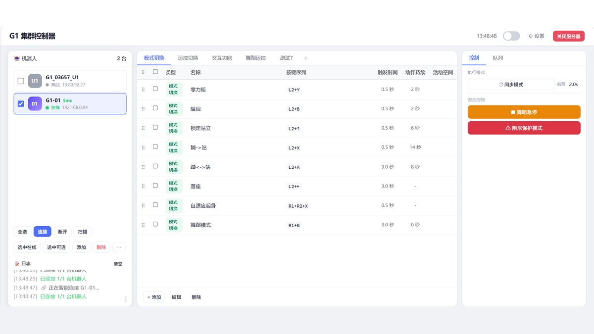
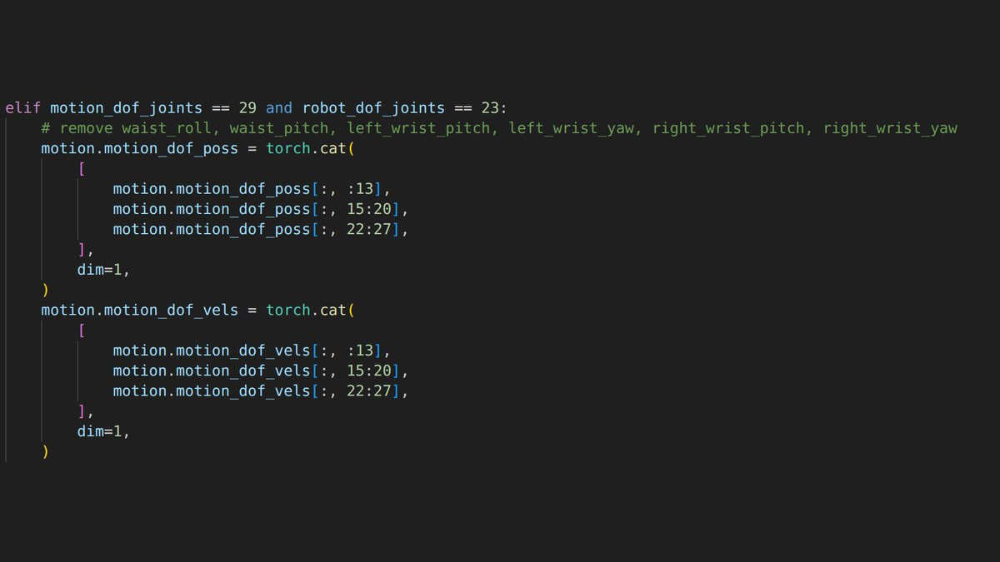
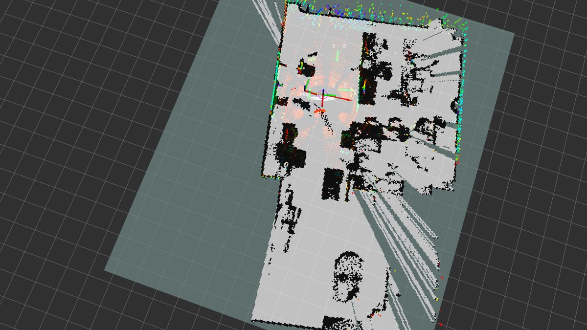

## 为什么会有这道题

G1 有两个常见型号：29 自由度和 23 自由度。差别在腰部——29dof 多了 `waist_roll` 和 `waist_pitch` 两个自由度。

官方的 `unitree_rl_lab` 只有 29dof 的 mimic 配置。把 29dof 训练出来的策略直接部署到 23dof 的机身上，会报错；就算勉强跑起来，动作也不稳——机器人会一直后退，站不住。

原因不难理解：策略的输入是 29 维的动作张量，机身只有 23 个关节。少掉的两个自由度是**腰部的俯仰和横滚**，而这两个恰恰是保持平衡时用得最多的。

所以要做的是：在动作数据层面把 29 维裁成 23 维，同时把缺失自由度的姿态用别的方式补偿掉，让策略重新训练。

下面是整条链路，按实际跑通的顺序。


## 一、从视频提取人体动作

用 GVHMR 从单目视频估算人体参数，导出 `hmr4d_results.pt`。

```bash
conda activate gvhmr
cd ~/unitree/GVHMR
python tools/demo/demo.py --video=docs/example_video/kunkun.mp4 -s
```

要点：**视频帧率要记下来**。后面 `csv_to_npz.py` 的 `--input_fps` 必须和原视频一致，否则动作整体会变快或变慢。

## 二、重定向到 G1 骨架

用 GMR 把 SMPL-X 的人体参数重定向到 unitree_g1 的骨架，导出 pkl。

```bash
conda activate gmr
cd ~/unitree/GMR
python scripts/gvhmr_to_robot.py \
  --gvhmr_pred_file ../GVHMR/outputs/demo/kunkun/hmr4d_results.pt \
  --robot unitree_g1 \
  --record_video \
  --save_path ./output_pkl/kunkun.pkl
```

重定向这一步最容易出问题：**穿模**和**动作跳变**。重定向出来的动作在人身上看着正常，到机器人身上就是手臂穿过躯干、或者某个瞬间关节速度突变。

## 三、转成 BeyondMimic 认的格式

```bash
python scripts/batch_gmr_pkl_to_csv.py --folder ./output_pkl
```

批量转成 csv，输出在 `./output_pkl/csv`。

## 四、修动作数据

这一步不能跳。用 CSV Editor 打开动作曲线，配合 23dof 的机器人模型文件 `g1_23dof_rev_1_0.xml`，逐段修。

几个实际用法：

- 黄色竖线中间的蓝色区域是编辑生效的范围
- `ctrl` + 鼠标左键拖动曲线，手动改某一段
- 直线 / 曲线连接可以把区间两端的值平滑接上
- **savgol 滤波**处理抖动——这是解决"动作跳变"的主力工具
- 红线处可以插帧，用来做初始位姿设置和动作之间的过渡

> 注意：**载入的必须是 29dof 的原始 csv**。23dof 的动作文件格式和编辑器要求不一致，直接载入会映射错位，动作就不对了。

裁剪的核心就是把腰部两个自由度的列从张量里去掉，下面这段是实际在跑的代码。

## 五、裁剪成 23 维并转 npz

把修好的 `kunkun.csv` 放到 `unitree_rl_lab/scripts/mimic` 下：

```bash
python scripts/mimic/csv_to_npz.py --input_fps 60 --input_file ./scripts/mimic/kunkun.csv
```

裁剪逻辑就几行——把腰部两个自由度对应的列从张量里去掉：

```python
elif motion_dof_joints == 29 and robot_dof_joints == 23:
    # remove waist_roll, waist_pitch, left_wrist_pitch,
    #        left_wrist_yaw, right_wrist_pitch, right_wrist_yaw
    motion.motion_dof_pos = torch.cat([
        motion.motion_dof_pos[:, :13],
        motion.motion_dof_pos[:, 15:20],
        motion.motion_dof_pos[:, 22:27],
    ], dim=1)
```

三个切片把 29 列拼成 23 列。速度张量同理。

**等它打印出 `Motion npz file saved to ...` 再中断终端**，否则 npz 是残缺的。

训练日志里会看到奖励曲线慢慢抬起来。这一步的中间产物是 onnx，但它离真机还差一整套部署配置。





## 六、训练与部署

复制 `g1_23dof/sample` 目录改名，放入 npz，改 `__init__.py` 里的 id 和 `tracking_env_cfg.py` 里的 `motion_file`，然后：

```bash
python scripts/rsl_rl/train.py \
  --task Unitree-G1-23dof-Mimic-Kunkun \
  --num_envs 4096 --device cuda:0 --headless
```

`--headless` 关掉 IsaacSim 的可视化，4096 个环境并行，训练快很多。

导出 onnx 之后，部署前**必须改 `joint_ids_map`**。这是最容易漏的一步：

```yaml
# 29dof
joint_ids_map: [0, 6, 12, 1, 7, 13, 18, 2, 8, 14, 19, 3, 9, 15, 20, 4, 10, 16, 21, 5, 11, 17, 22]
# 23dof（少了 13、18 等对应腰部的位置）
joint_ids_map: [0, 6, 12, 1, 7, 15, 22, 2, 8, 16, 23, 3, 9, 17, 24, 4, 10, 18, 25, 5, 11, 19, 26]
```

映射错了，机器人会在上电的瞬间做一个完全不对的动作——这是现场最危险的一步，务必先吊起来试。

上机前我一般先把机器人吊起来，让它空跑一遍动作。下面这张是建图和定位的界面，运控那条线用的是另一套工具，但"先在软件里看一遍再上机"的习惯是一样的。



## 六道验证，一道都不能省

把这条链路总结成一张表：

| 阶段 | 过不了会怎样 |
|---|---|
| 动作提取 | 帧率不对，动作整体变速 |
| 重定向 | 穿模、跳变，后续怎么调都救不回来 |
| 数据修正 | 不修就直接训练，策略学不出来 |
| 裁剪 + 训练 | 维数不对，直接报错 |
| 跨引擎复验 | 只在 IsaacSim 里对，真机上就是另一回事 |
| 真机调优 | 地面材质、灯光、负载都会改变结果 |

> **我的规矩：任何一道没过都不上真机。**
> 有吊机牵着的时候看着还行，松了吊机就散架——这种事发生过不止一次。

## 现状

代码已提 [PR #121](https://github.com/unitreerobotics/unitree_rl_lab/pull/121) 到官方 `unitree_rl_lab` 仓库，补充 23dof U1 型号的适配。**目前仍在 review，没有合入。**

这件事还没收尾：舞蹈能跳，但稳定性还在收敛。"能跳"和"能当众跳"是两件不同的事。

同一套链路后来也用在了场馆导览和群控的交付上，那些是另一条线的故事。
