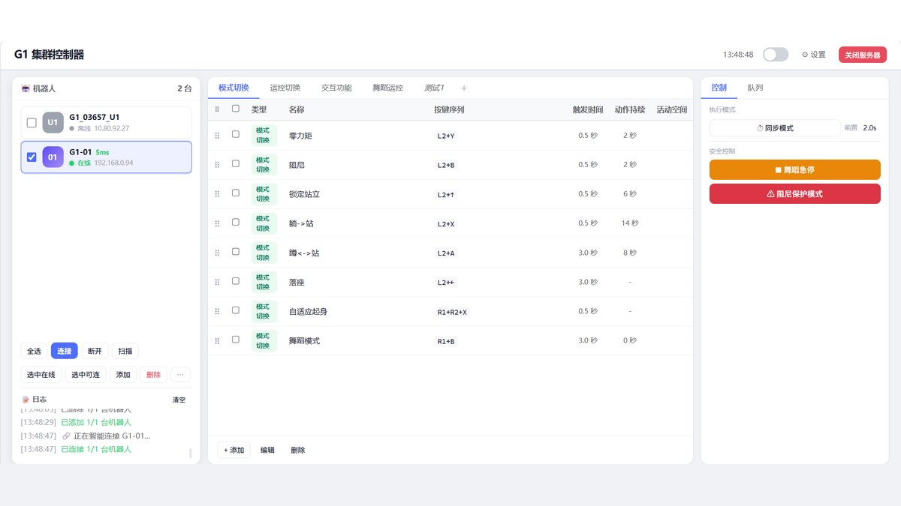
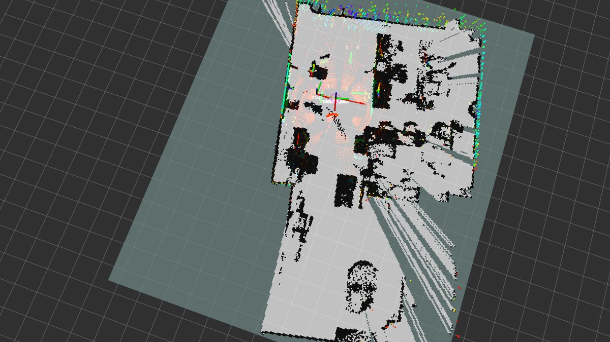
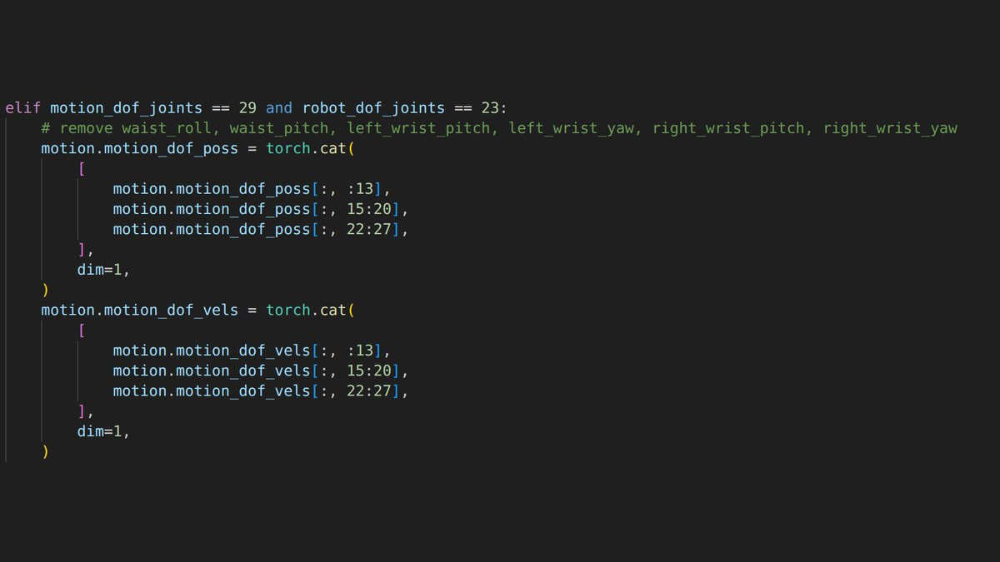

<section class="cv-sec">
  <h2 class="cv-h2">教育</h2>
  

    

      
2023.09 – 2027.06

      
深圳技术大学 · 计算机科学与技术 · 本科

      
GPA 3.27 / 4.0 · 专业排名 63 / 155（前 40%）

      

        相关课程：人工智能导论、Prompt 提示词工程、深度学习、复杂网络与图表示学习。
        SZTU 百度人工智能菁英班成员。
      

    

  

</section>

<section class="cv-sec">
  <h2 class="cv-h2">项目</h2>

  

    <figure class="cv-feat-media">
      
    </figure>
    

      
2026.05

      <h3 class="cv-wat">多机群控软件 · 组长</h3>
      

        通过 TCP 桥接 unitree_ros2 的 <code>wirelesscontroller</code> 话题，基于 WirelessController
        消息与 xKeySwitchUnion 位掩码做远程控制；NTP 负责多机时间同步。
        集成 SSH/SFTP 快速部署与 RSA License 激活。
      

      
<b>已交付 3 个客户、3 套系统</b>，走完从需求沟通、部署交付到售后维护的完整一轮。

    

  

  

    <figure class="cv-feat-media">
      
    </figure>
    

      
2026.01

      <h3 class="cv-wat">G1 导览机器人</h3>
      

        本体 Jetson 上的导航与语音导览：ROS 建图、点云转 2D 栅格、定位、路径规划，
        接 RViz 点位可视化、固定点导航、语音播报与对话、上肢动作控制。
        后端 Python/Flask，前端 React，点位存 SQLite。场馆侧有后台，改站点与讲解词不用找我们。
      

      
<b>已交付 7 台设备、3 个客户</b>；学院楼线路 13 个站点，直线约 240 米。这一套同时是本科毕业设计。

    

  

  

    <figure class="cv-feat-media">
      
    </figure>
    

      
2025.09

      <h3 class="cv-wat">人形机器人强化学习全身运动控制 · 组长</h3>
      

        基于 GMR 从人体动作视频构建动作数据集，用 CSV Editor 与 savgol 平滑滤波解决 retarget
        后的动作跳变；BeyondMimic 模仿学习框架训练，Isaac Lab 与 MuJoCo 做仿真训练和 sim2sim
        验证，最后 sim2real 上真机。
      

      <ul class="cv-list">
        <li>官方 unitree_rl_lab 不支持 G1 23dof 的舞蹈动作，团队补了 23dof 的 mimic 配置</li>
        <li>写动作数据裁剪脚本，把 29 维动作张量裁成 23 维（去掉腰部两个自由度）</li>
        <li>新增 23dof 训练配置，含关节名称与电机限位；补控制器 C++ 代码</li>
        <li>完成 23dof U1 型号适配，实现 mimic 舞蹈真机部署</li>
      </ul>
      
代码已提 <a href="https://github.com/unitreerobotics/unitree_rl_lab/pull/121" target="_blank" rel="noopener">PR #121</a> 到官方仓库，目前仍在 review，<b>未合入</b>。

    

  

  

    
2025.07

    <h3 class="cv-wat">腾讯 Mini 项目 · 多模态文生图自动评测 · 组长</h3>
    

      以 MLLM 作为评分模型构建 Text-to-Image 自动评测体系，替代人工打分。
      评测速度 168.5 用例/小时，与人类评分一致率 90.2%。
    

  

</section>

<section class="cv-sec">
  <h2 class="cv-h2">技能</h2>
  

    

      
编程

      
Python（PyTorch / OpenCV / NumPy / Matplotlib / PaddlePaddle）、C++、MATLAB、SQL

    

    

      
机器人

      
ROS / ROS2、Isaac Lab、MuJoCo、RViz、unitree_ros2、SLAM、路径规划、Sim2Real

    

    

      
领域

      
强化学习、模仿学习、全身运动控制、多机时间同步、多模态模型评测

    

    

      
工具

      
Git、Docker、Linux、SSH/SFTP、CMake

    

  

</section>

<section class="cv-sec">
  <h2 class="cv-h2">获奖</h2>
  <ul class="cv-list cv-awards">
    <li>蓝桥杯程序设计竞赛 B 组 C/C++ · 全国总决赛优秀奖、广东省一等奖</li>
    <li>高教社杯全国大学生数学建模竞赛 · 广东省三等奖</li>
    <li>睿抗机器人大赛 2025 CAIP AI 视觉应用赛 · 广东省三等奖</li>
    <li>SZTU「科创之星」奖学金二等奖、优秀新生三等奖学金</li>
  </ul>
</section>

<section class="cv-sec">
  <h2 class="cv-h2">联系</h2>
  

    <a href="mailto:202300202023@stumail.sztu.edu.cn">202300202023@stumail.sztu.edu.cn</a>
    <a href="https://github.com/chenlockyer" target="_blank" rel="noopener">github.com/chenlockyer</a>
    <a href="https://chenlockyer.github.io/studio/" target="_blank" rel="noopener">工作室 · 落地交付</a>
  

</section>
