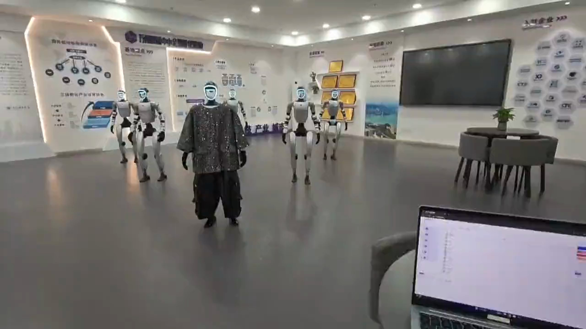
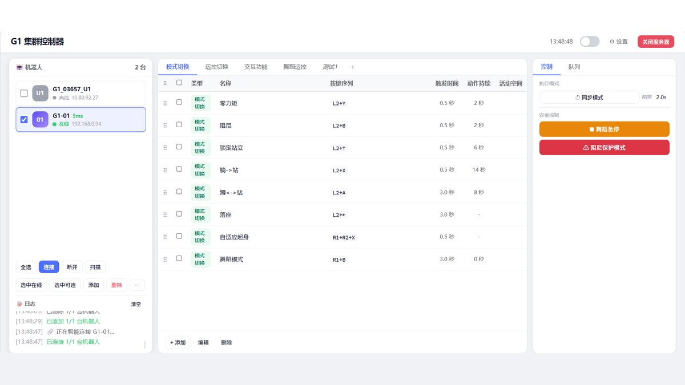
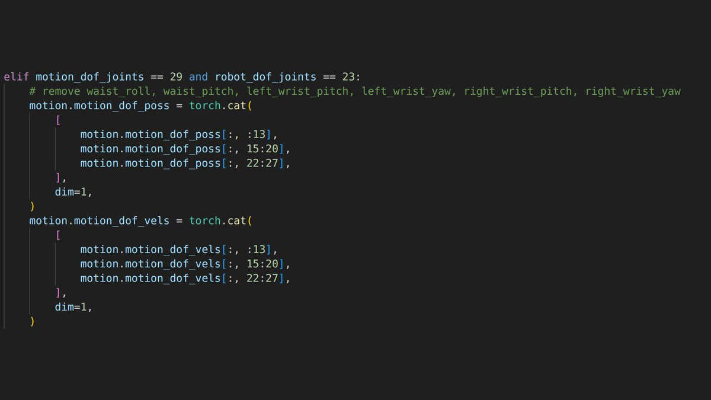
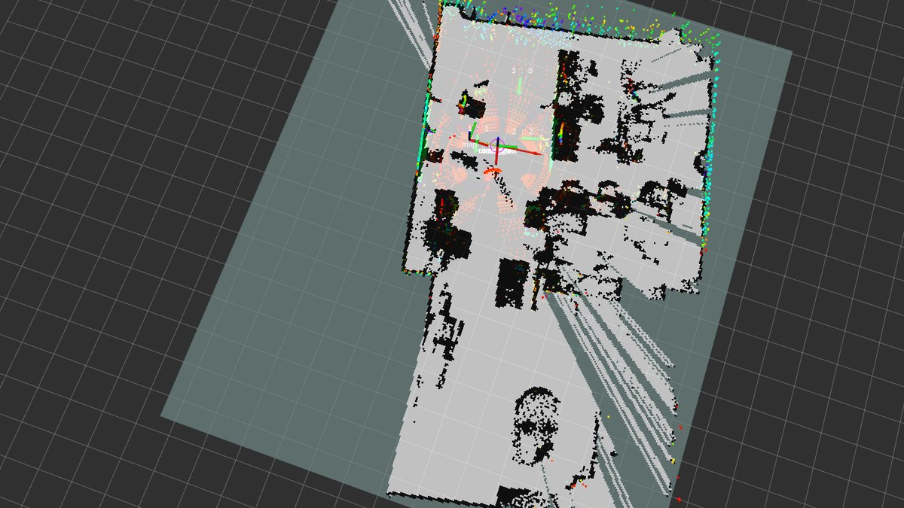

<h2>我在用的东西</h2>

  下面这些是我实际在项目里用到的仓库和工具。不是收藏夹，是每天打开的那些。

  

    <h3>机器人本体与训练</h3>
    <ul class="link-list">
      <li><a href="https://github.com/unitreerobotics/unitree_rl_lab" target="_blank" rel="noopener">unitree_rl_lab</a>宇树官方 RL 训练框架。我提了 PR #121 补 23dof 适配</li>
      <li><a href="https://github.com/unitreerobotics/unitree_ros2" target="_blank" rel="noopener">unitree_ros2</a>宇树 ROS2 驱动，群控的 TCP 桥接就建在它上面</li>
      <li><a href="https://isaac-sim.github.io/IsaacLab/" target="_blank" rel="noopener">Isaac Lab</a>大规模并行 RL 训练环境，4096 环境跑满要多卡</li>
      <li><a href="https://github.com/google-deepmind/mujoco" target="_blank" rel="noopener">MuJoCo</a>跨引擎复验用的物理仿真</li>
    </ul>
  

  

  

    <h3>动作数据</h3>
    <ul class="link-list">
      <li><a href="https://github.com/zju3dv/GVHMR" target="_blank" rel="noopener">GVHMR</a>从单目视频估算人体参数</li>
      <li><a href="https://github.com/YanjieZe/GMR" target="_blank" rel="noopener">GMR</a>把人体骨架重定向到机器人本体</li>
    </ul>
  

  

  

    <h3>导航</h3>
    <ul class="link-list">
      <li><a href="https://www.ros.org/" target="_blank" rel="noopener">ROS / ROS2</a>机器人中间件</li>
      <li><a href="https://github.com/ros-navigation/navigation2" target="_blank" rel="noopener">Navigation2</a>路径规划与代价地图</li>
      <li><a href="http://wiki.ros.org/rtabmap_ros" target="_blank" rel="noopener">RTAB-Map</a>建图与定位的常用方案</li>
    </ul>
  

  

    <h3>我写的东西</h3>
    <ul class="link-list">
      <li><a href="https://github.com/unitreerobotics/unitree_rl_lab/pull/121" target="_blank" rel="noopener">PR #121 · 23dof 适配</a>给官方仓库补 G1 23dof 的 mimic 配置，仍在 review</li>
      <li><a href="https://github.com/chenlockyer/mini-project" target="_blank" rel="noopener">腾讯 Mini 项目</a>多模态文生图自动评测</li>
      <li><a href="https://github.com/chenlockyer" target="_blank" rel="noopener">GitHub</a>其他公开的代码</li>
    </ul>
  

<h2>交换友链</h2>

  欢迎交换友链，在 <a href="https://github.com/chenlockyer/chenlockyer.github.io/issues" target="_blank" rel="noopener">GitHub Issues</a> 或邮件联系我。

